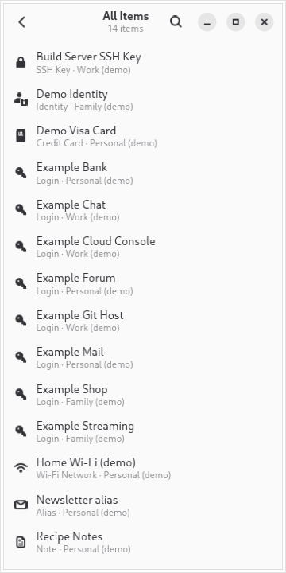
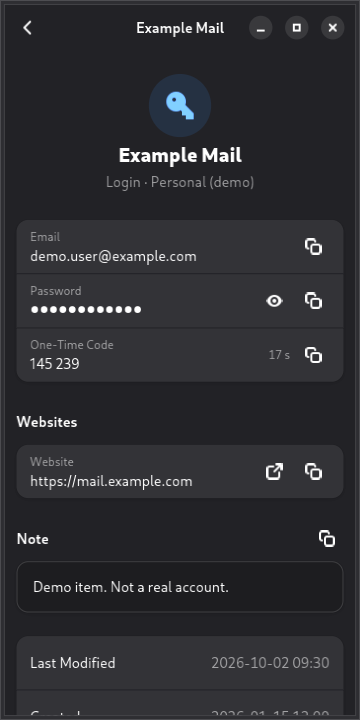
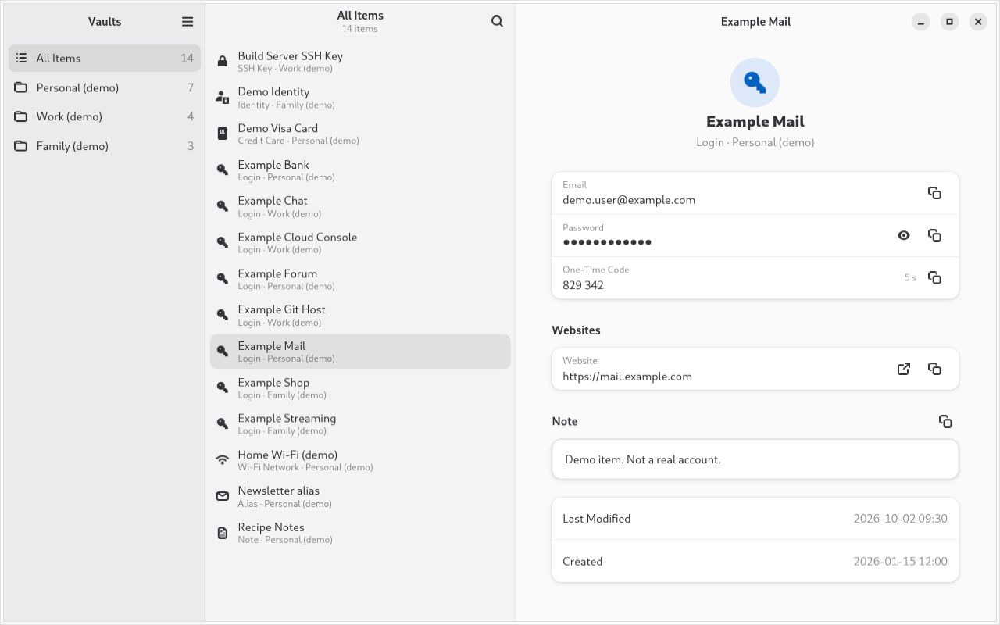

# Proton Pass GTK

An adaptive GTK 4 / libadwaita front end for Proton's official command-line
tool, [`pass-cli`](https://github.com/protonpass/pass-cli). It is built for
mobile Linux (Phosh / BengalOS on the Fairphone 5, 360–408 px portrait) and
for the desktop, and it follows the GNOME HIG.

> Unofficial. Not affiliated with or endorsed by Proton AG. This app does not
> implement Proton's auth or crypto. It drives `pass-cli`.

| Phone (360×720) | | Desktop (1280×800) |
|---|---|---|
|  |  |  |

The screenshots use the built-in **mock backend**. All data in them is fake.

## Status: scaffold (v0.1.0)

Working with the mock backend, and wired to pass-cli:

- Sign-in page (AdwStatusPage). It runs `pass-cli login` (web login: SSO, 2FA
  and security keys), opens the printed URL with `Gtk.UriLauncher`, and closes
  when pass-cli finishes.
- Vault list with an **All Items** entry and item counts.
- Item list (`GtkListView`) with type icons and live search (Ctrl+F, or just
  start typing).
- Item details (AdwPreferencesPage with property rows):
  - copy buttons for username, email, password, one-time code, URLs and notes;
  - password reveal that hides itself again after 30 s;
  - live TOTP with a countdown;
  - custom fields and sections, card, Wi-Fi, SSH key and identity fields.
- Clipboard auto-clear after 30 s (`PPG_CLIPBOARD_CLEAR_SECONDS`). It only
  clears if the clipboard still holds what the app copied. Secrets also carry
  `x-kde-passwordManagerHint: secret`, so clipboard managers can skip them.
- Toasts, a sign-out confirmation (AdwAlertDialog), an About dialog and a
  shortcuts window.
- Adaptive layout: two nested `AdwNavigationSplitView`s. An `AdwBreakpoint`
  collapses the vault sidebar at ≤ 860 sp and both panes at ≤ 600 sp.
- Dark mode follows the system (AdwStyleManager default). You can force it
  with `PPG_COLOR_SCHEME=dark|light`.
- Accessibility: icon-only buttons have accessible labels and tooltips, list
  rows have accessible labels, and masked values are announced as "Hidden".

Not done yet: see [Next steps](#next-steps).

## Running

Requirements: Python ≥ 3.10, PyGObject, GTK ≥ 4.12, libadwaita ≥ 1.5 and
`pass-cli` (≥ 2.5; tested with 2.7.0).

```sh
# Debian / BengalOS / Mobian
run0 apt install python3-gi gir1.2-gtk-4.0 gir1.2-adw-1 meson
# Arch
run0 pacman -S python-gobject gtk4 libadwaita meson

# demo data, no account needed
PPG_BACKEND=mock PYTHONPATH=src python3 -m protonpassgtk

# real pass-cli (on $PATH, ~/.local/bin, or PPG_PASS_CLI=/path/to/pass-cli)
PYTHONPATH=src python3 -m protonpassgtk
```

Install with meson:

```sh
meson setup _build --prefix="$HOME/.local"
meson test -C _build     # pytest + desktop-file and metainfo validation
meson install -C _build
```

Flatpak (not published): `flatpak-builder --user --install _flatpak
build-aux/flatpak/io.github.isyourbrainfoss.ProtonPassGtk.json`. The manifest
bundles the official pass-cli 2.7.0 binary for x86_64 and aarch64 with
SHA-256 pinning, and sets `PROTON_PASS_LINUX_KEYRING=dbus`, because
Flatpak's seccomp filter blocks the kernel keyring.

### On a Phosh phone

pass-cli stores its session key in the **kernel keyring** by default, and
that keyring is cleared on every reboot. To keep the session across reboots
on Phosh, set this in the session environment (gnome-keyring is running):

```sh
export PROTON_PASS_LINUX_KEYRING=dbus
```

### aarch64 (Fairphone 5) testing without the phone

The official `pass-cli-linux-aarch64` binary runs on an x86_64 box through
qemu-user binfmt. You can also run the whole app inside an arm64 Debian
trixie rootfs, made with `mmdebstrap --arch=arm64` and including
`python3-gi gir1.2-adw-1 gir1.2-gtk-4.0 adwaita-icon-theme`. Point it at a
host Xvfb with `GSK_RENDERER=cairo`; see
`screenshots/arm64-qemu-phone-360x720-detail-dark.png`. Limits under
qemu-user:

- `keyctl` is not emulated (ENOSYS), so pass-cli's default kernel keyring
  fails ("Error creating client features"). Set
  `PROTON_PASS_KEY_PROVIDER=fs` for emulated tests only.
- Packaging must pull in `librsvg2-common`, or some SVG icons do not render.
- Touch, OSK (squeekboard), scale 3 and Wayland/Phoc need the real device or
  a Phosh VM.

## Environment variables

| Variable | Meaning |
|---|---|
| `PPG_BACKEND=mock` | Fake demo backend (no account, no network) |
| `PPG_MOCK_SIGNED_OUT=1` | Mock starts on the sign-in page |
| `PPG_PASS_CLI=/path` | pass-cli binary to use |
| `PPG_CLIPBOARD_CLEAR_SECONDS` | Clipboard auto-clear delay (default 30, 0 = off) |
| `PPG_COLOR_SCHEME=dark\|light` | Force the colour scheme |

## Security rules (for contributors)

- Never store, log, print or echo secrets. `parse_item_view` drops every
  secret value (password, card number, hidden fields, TOTP URIs and so on).
  The model only records that the field exists. Values are fetched one at a
  time with `pass-cli item view --field …` or `item totp` when the user copies
  or reveals them, and are not kept.
- Never put secrets on a command line, and never pass `--show-secrets`.
- Error messages are cut down to one stderr line. Parse errors never echo the
  payload.
- Tests use obviously fake values and assert that they do not leak into the
  models.

## Layout

```
src/protonpassgtk/
  main.py          Adw.Application, accels, shortcuts window, about
  window.py        split views, breakpoints, vault/item lists, search, copy
  item_view.py     details page (rows, reveal, TOTP)
  login.py         sign-in dialog around `pass-cli login`
  clipboard.py     copy + auto-clear
  parsing.py       pass-cli JSON → models (no GTK, unit tested)
  backend/         base interface, pass-cli (Gio.Subprocess, async), mock
data/              desktop file, metainfo, icons (placeholders)
build-aux/         flatpak manifest, screenshot tooling, fetch-pass-cli.sh
docs/PASS-CLI.md   what pass-cli supports and its JSON shapes
tests/             pytest (parsing, argv)
```

Screenshots: `build-aux/screenshots.sh` renders every state with the mock
backend under Xvfb into `screenshots/`.

## Next steps

1. Test against a real account (needs a Pass plan that is allowed to use the
   CLI), and check the JSON shapes against `tests/fixtures`.
2. Support the Pass extra password: ask in an AdwPasswordEntry and pass it to
   the child process through `PROTON_PASS_EXTRA_PASSWORD_FILE` on a memfd or
   pipe, never on argv.
3. GSettings: clipboard timeout, window size, last vault.
4. Search usernames and URLs. `item list` only exposes titles, so this needs
   an opt-in, in-memory, non-secret index.
5. Session lock (`pass-cli session lock/unlock`) and auto-lock on idle.
6. Create and edit items, trash, password generator (`password generate`).
7. Test on the Fairphone 5 (Phosh, touch, OSK, scale 3) and on Arch.
8. Translations (gettext/po), a real app icon, and Flathub review.

## License

GPL-3.0-or-later. See [LICENSE](LICENSE). pass-cli itself is also
GPL-3.0-or-later (Proton AG).
